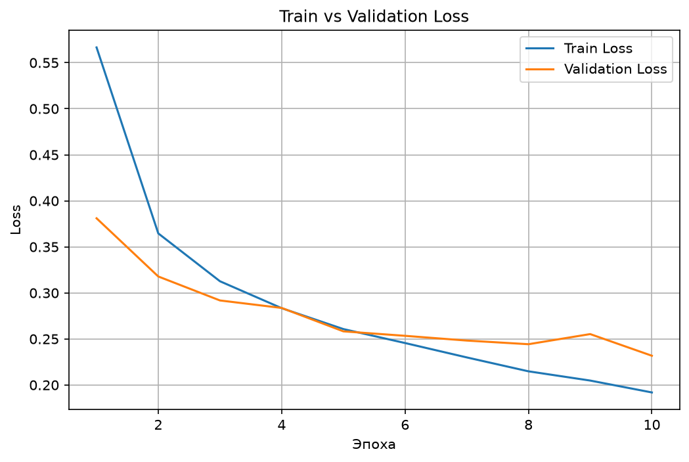
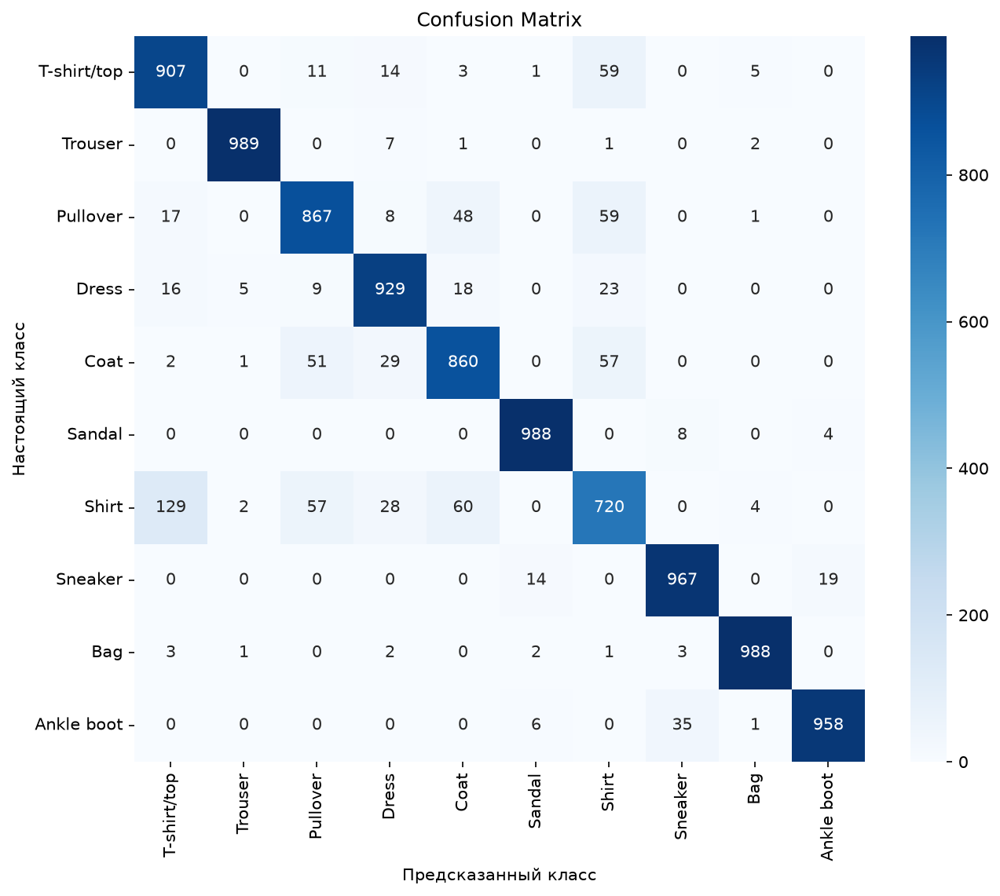

# Fashion-MNIST Classification with CNN

Классификация изображений одежды (10 классов) с помощью свёрточной нейросети на PyTorch.

## Датасет
[Fashion-MNIST](https://github.com/zalandoresearch/fashion-mnist): 60 000 train / 10 000 test изображений, 28×28 пикселей, чёрно-белые, 10 классов одежды.

## Архитектура
- Conv2d(1→16) → ReLU → MaxPool
- Conv2d(16→32) → ReLU → MaxPool
- Flatten → Linear(1568→128) → Dropout(0.3) → Linear(128→10)

## Обучение
- Optimizer: Adam (lr=0.001)
- Loss: CrossEntropyLoss
- 10 эпох, batch size 64

## Результаты
**Test accuracy: 91.73%**

После ~6 эпохи заметны первые признаки переобучения: train loss продолжает падать, а validation loss выходит на плато и слегка колеблется.



## Анализ ошибок

Confusion matrix показывает, что основная путаница происходит между визуально похожими классами верхней одежды — **Shirt, Pullover, Coat, T-shirt/top**. Например, Shirt путается с T-shirt/top в 129 случаях из 1000, с Coat — в 60, с Pullover — в 57.

При этом классы с уникальным силуэтом (Trouser, Sandal, Bag, Ankle boot) распознаются почти безошибочно — F1-score выше 0.97 для каждого.



## Classification Report

| Класс | Precision | Recall | F1 |
|---|---|---|---|
| T-shirt/top | 0.84 | 0.91 | 0.87 |
| Trouser | 0.99 | 0.99 | 0.99 |
| Pullover | 0.87 | 0.87 | 0.87 |
| Dress | 0.91 | 0.93 | 0.92 |
| Coat | 0.87 | 0.86 | 0.86 |
| Sandal | 0.98 | 0.99 | 0.98 |
| Shirt | 0.78 | 0.72 | 0.75 |
| Sneaker | 0.95 | 0.97 | 0.96 |
| Bag | 0.99 | 0.99 | 0.99 |
| Ankle boot | 0.98 | 0.96 | 0.97 |

## Возможные улучшения
- Early stopping (видно начало переобучения после эпохи 6)
- Data augmentation (повороты, сдвиги) для лучшего обобщения
- Более глубокая архитектура или batch normalization

## Запуск
```bash
pip install -r requirements.txt
jupyter notebook fashion_mnist_cnn.ipynb
```